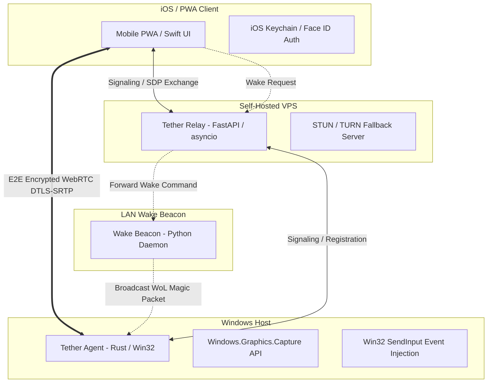

# Tether (Bgrok) ⚡

**Zero-trust, end-to-end encrypted remote desktop and application launcher bridging Windows workstations to mobile devices over WebRTC and WebSockets.**

---

## 📌 Overview

Traditional remote access solutions (RDP, TeamViewer, AnyDesk) either rely on proprietary cloud middlemen that broker unencrypted video streams, or require dangerous open ports and complex VPN configurations. 

**Tether** is a self-hosted, lightweight remote access architecture designed for low-latency desktop control from mobile devices (iOS / PWA) without port forwarding or third-party cloud surveillance.

---

## 🏛️ System Architecture



---

## 🔑 Core Components

| Component | Responsibility | Technology Stack |
| :--- | :--- | :--- |
| **Tether Agent** | Screen capture via hardware acceleration, input injection, and app launch handler | **Rust (`windows-rs`, `webrtc-rs`) / Python** |
| **Tether Relay** | Asynchronous signaling, peer discovery, SDP exchange, and TURN fallback relay | **Python (FastAPI, asyncio, WebSockets)** |
| **Wake Beacon** | Persistent LAN listener receiving authenticated wake requests and broadcasting WoL | **Python daemon** |
| **Client** | High-performance mobile viewport, touch-to-mouse mapping, and session controls | **Swift (iOS) / Next.js PWA** |

---

## 🛡️ Security Model

* **End-to-End Encryption (DTLS-SRTP):** Screen frames and input events (mouse, keyboard, launch triggers) ride exclusively inside WebRTC's mandatory DTLS-SRTP layer. The Relay only handles encrypted packets and cannot view session content.
* **Cryptographic Device Pairing:** Public-key cryptography binds the mobile client to the host workstation. Private keys remain strictly inside the local iOS Keychain protected by biometric authentication (Face ID / Touch ID).
* **Zero Open Ports:** Outbound-only persistent connections from the host workstation bypass NAT restrictions and firewall boundaries cleanly without exposing open ports to the public internet.

---

## 🚀 Quickstart & Local Setup

### 1. Prerequisites
* **Python 3.10+**
* **Rust toolchain** (for native Agent compilation)
* **Windows 10/11** (for host capture)

### 2. Start the Signaling Relay
```bash
# Navigate to the relay directory
cd relay

# Install dependencies
pip install -r requirements.txt

# Start the signaling server
python -m uvicorn server:app --host 0.0.0.0 --port 8765
```

### 3. Launch the Windows Host Agent
```bash
# Navigate to the agent directory
cd agent

# Run the agent daemon
python agent.py --relay wss://your-relay-host:8765
```

### 4. Connect via Client
Open the mobile client or web interface, scan the pairing QR code generated by the agent, and initiate the encrypted session.

---

## 🧪 Testing & Verification

Run the test suite across signaling and WebRTC components:
```bash
pytest test_wgc.py -v
```

---

## 📄 License
This project is licensed under the MIT License.
